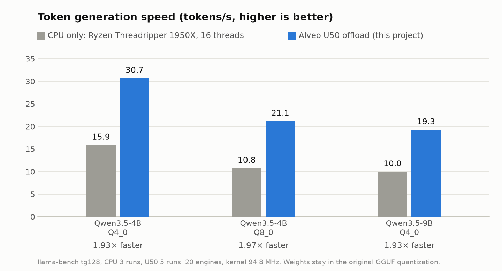

# fpga-llama-gguf

This project adds an AMD **Alveo U50** backend to [llama.cpp](https://github.com/ggml-org/llama.cpp). The backend
moves the token generation (decode) of Qwen3.5 models to the card.

An HLS kernel with 20 engines calculates the matrix-vector products and the related layer operations. The kernel
reads the weights in their **original GGUF quantization** (Q4_0, Q8_0, Q5_K, Q6_K). There is no requantization.
Because of this, the card calculates the same model as the CPU.

> **Pre-release.** We tested the project on one machine with Qwen3.5-4B and Qwen3.5-9B only. Read
> [Limitations](#limitations) before you use it.

<picture>
  <source media="(prefers-color-scheme: dark)" srcset="docs/images/benchmark-dark.png">
  
</picture>

## Results

Token generation in tokens/s, `llama-bench` with 128 generated tokens and 16 threads. U50: mean of 5 runs. CPU:
mean of 3 runs. The CPU is the host CPU of the card (AMD Ryzen Threadripper 1950X, 16 cores, no AVX-512).

| Model (GGUF) | CPU only | Alveo U50 | Speed-up |
| --- | --- | --- | --- |
| Qwen3.5-4B Q4_0 | 15.87 | **30.66** | 1.93× |
| Qwen3.5-4B Q8_0 | 10.75 | **21.13** | 1.97× |
| Qwen3.5-9B Q4_0 | 9.98 | **19.26** | 1.93× |

Bitstream: 20 engines, kernel clock 94.8 MHz, HBM clock 347.9 MHz. All values use the direct register start of the
kernel (refer to [docs/BUILD.md](docs/BUILD.md#43-direct-start)). The CPU values come from the same host and the same
llama.cpp commit (measured in October 2026).

### Performance history

All values are in tokens/s. We measured them on the same host with the same models.

| Date | Change | Engines | Kernel / HBM clock | 4B Q4_0 | 4B Q8_0 | 9B Q4_0 |
| --- | --- | --- | --- | --- | --- | --- |
| – | CPU only (reference) | – | – | 15.87 | 10.75 | 9.98 |
| 2026-10-07 | first pre-release | 16 | 96.1 MHz / – | 22.13 | 15.96 ¹ | 14.17 |
| 2026-10-10 | fused commands, DeltaNet state in the chip | 16 | 100 MHz / 346.6 MHz | 24.17 | 18.31 | 15.88 |
| 2026-11-07 | bitstream of 2026-10-10 with the current backend ² | 16 | 100 MHz / 346.6 MHz | 27.93 | 19.39 | 17.38 |
| 2026-11-07 | `ssm_out` in the DeltaNet pass, sigmoid gate, cycle trace | 16 | 98.8 MHz / 395.1 MHz | 27.88 | 18.61 | 17.13 |
| 2026-11-07 | 20 engines, output head on the card | 20 | 94.8 MHz / 347.9 MHz | **30.66** | **21.13** | **19.26** |

¹ 64 generated tokens.
² We did not isolate the cause of the difference to the row above.

Notes:

- The memory bandwidth limits the decode speed. The 20 engines read the weights from HBM at a maximum of 121 GB/s
  (20 × 64 bytes × 94.8 MHz). For a full token, the card gets 90–101 GB/s.
- Without the direct register start, each of the 10–14 kernel launches for a token takes 0.2 ms more. The speed
  then decreases by 12–15 %.
- The prompt (prefill) runs on the CPU at CPU speed. The card does not make it faster. Refer to
  [Limitations](#limitations).

## Function

```
llama.cpp  ──►  ggml backend "XRT" (llama.cpp/overlay)  ──►  gemvqc16 kernel on the U50 (fpga/src)
                  repacks each weight tensor one time          20 engines, one HBM channel for each engine
                  makes command lists, fuses nodes             GEMV, RMSNorm, add, SwiGLU, conv, RoPE, DeltaNet
```

- **Command lists.** The backend puts a sequence of supported ggml nodes into one command list. It starts the
  kernel one time for each list. A token needs 14 launches (Q4_0 models) or 10 launches (Q8_0). The activations stay
  on the card between the commands.
- **Fused commands.** One pass does a maximum of four GEMVs on the same input and quantizes the input one time. The
  result writer applies SwiGLU, the residual add and the convolution. The kernel applies the norm of the next layer
  when it quantizes the input of that layer.
- **GGUF weights.** At load time, the backend arranges the scales and quants of each weight tensor into 64-byte
  words. The bits do not change.
- **DeltaNet on the card.** The recurrent states of Qwen3.5 stay in HBM. One command does a full Gated DeltaNet step
  on a copy of the state in the chip. The same pass calculates the output projection (`ssm_out`).
- **Work on the CPU:**
  - the attention core (QK, softmax, V) of the 8 attention layers
  - the prompt and the sampler
  - tensors in formats that the card does not support.

For more data, refer to [docs/DESIGN.md](docs/DESIGN.md). For the plan to increase the speed, refer to
[docs/ROADMAP.md](docs/ROADMAP.md).

## Requirements

| Item | Tested with |
| --- | --- |
| Card | AMD Alveo U50 (`xcu50-fsvh2104-2-e`, 8 GB HBM2), deployment platform `xilinx_u50_gen3x16_xdma_5_202210_1` |
| Host | Linux (Ubuntu 24.04), x86-64, GCC 13, CMake 3.14 or later, Ninja, git |
| Run time | AMD XRT 2.26.0 (upstream commit `11169ba5`) with its `xocl` driver |
| Bitstream build | **Vitis / Vivado 2025.2** (with Vitis HLS), 48 GB RAM, 3–4 hours |
| llama.cpp | commit **`c92e806d1c81091c9035edce99c35374da1b465e`** (11 July 2026) with the patches of this repository |

The build script downloads llama.cpp at the commit above. Other llama.cpp versions need updated patches.

## Quick start

1. Build llama.cpp with the U50 backend. The script applies the patches.

   ```bash
   source /opt/xilinx/xrt/setup.sh
   scripts/build_llama.sh                      # result: build/llama.cpp/build/bin
   ```

2. Build the bitstream (3–4 hours, Vitis/Vivado 2025.2).

   ```bash
   scripts/build_xclbin.sh                     # result: build/xclbin/gemvqc16.xclbin
   ```

3. Download the model files (refer to [Test data](#test-data)).
4. Run llama.cpp on the card.

   ```bash
   export GGML_XRT_KERNEL=gemvqc16
   export GGML_XRT_XCLBIN=$PWD/build/xclbin/gemvqc16.xclbin
   export OMP_WAIT_POLICY=ACTIVE
   build/llama.cpp/build/bin/llama-cli -m models/Qwen3.5-4B-Q4_0.gguf -ngl 99 -no-cnv -n 64 -p "The capital of France is"
   build/llama.cpp/build/bin/llama-bench -m models/Qwen3.5-4B-Q4_0.gguf -ngl 99 -p 512 -n 128 -r 3 -t 16
   ```

5. To get the results table (CPU only and U50 for the three test models), run `scripts/benchmark.sh`.

The first run uploads the repacked weights to the card. This takes some time.

To check the results of the card, set `GGML_XRT_VERIFY_CALLS=1000`. The backend then compares the first 1000
offloaded operations with a CPU reference. It shows `XRT-VERIFY: PASS` for each operation, or it stops. For the full
build procedure, the options and the fault isolation, refer to **[docs/BUILD.md](docs/BUILD.md)**.

You can use the backend without a card. Build with `VITIS_INCLUDE=/opt/Xilinx/2025.2/Vitis/include
scripts/build_llama.sh` and run with `GGML_XRT_EMULATE=1`. The host then runs the C++ model of the kernel. The
emulator is slow: one to two minutes for each token of the 4B model.

## Test data

We measured all values with these files. The files are not in this repository. Download them from Hugging Face and
compare the SHA-256.

| File | Size (bytes) | SHA-256 |
| --- | --- | --- |
| [`Qwen3.5-4B-Q4_0.gguf`](https://huggingface.co/unsloth/Qwen3.5-4B-GGUF/blob/main/Qwen3.5-4B-Q4_0.gguf) | 2,583,221,408 | `298fcb5fe7a77ccc79745ae24751560c5ac56874caff4bb39b1f2055bd72b8bb` |
| [`Qwen3.5-4B-Q8_0.gguf`](https://huggingface.co/unsloth/Qwen3.5-4B-GGUF/blob/main/Qwen3.5-4B-Q8_0.gguf) | 4,482,403,488 | `10cc391b403021dd11c614679d2fd92f611c3681d29e29651b717316965d61e1` |
| [`Qwen3.5-9B-Q4_0.gguf`](https://huggingface.co/unsloth/Qwen3.5-9B-GGUF/blob/main/Qwen3.5-9B-Q4_0.gguf) | 5,379,417,312 | `17670346b4260ddcb0173965145155885024f3c9a4a24389a3370751edbcde24` |

Sources: [unsloth/Qwen3.5-4B-GGUF](https://huggingface.co/unsloth/Qwen3.5-4B-GGUF) and
[unsloth/Qwen3.5-9B-GGUF](https://huggingface.co/unsloth/Qwen3.5-9B-GGUF). These files are quantizations of
[Qwen/Qwen3.5-4B](https://huggingface.co/Qwen/Qwen3.5-4B) and [Qwen/Qwen3.5-9B](https://huggingface.co/Qwen/Qwen3.5-9B)
(Apache-2.0).

```bash
mkdir -p models
curl -L -o models/Qwen3.5-4B-Q4_0.gguf \
  https://huggingface.co/unsloth/Qwen3.5-4B-GGUF/resolve/main/Qwen3.5-4B-Q4_0.gguf
sha256sum models/Qwen3.5-4B-Q4_0.gguf
```

The "Q4_0" files contain more than one format. The card calculates the Q4_0, Q8_0, Q5_K (`ssm_out`) and Q6_K
(output head) matrices. The four Q4_1 `ffn_down` tensors stay on the CPU.

## Limitations

- **Token generation only.** The prompt (batched matrix multiplication) runs on the CPU at CPU speed. The Q4_0
  weights stay in the repack format of the CPU. The backend restores the GGUF layout for its upload.
- **No speed-up for small models.** For each layer, the attention goes back to the CPU. The launch time and the copy
  time are then larger than the gain. Qwen2.5-0.5B ran at 0.3–0.5× of the CPU speed.
- **Model size.** The repacked weights must fit into the HBM arenas (20 × 250 MiB). The 9B Q4_0 model fits with its
  output head (225 of 250 MiB for each engine). A 9B Q8_0 model does not fit. If the output head does not fit, it
  stays on the CPU. The backend then shows `XRT Backend: output head on the CPU`.
- **Formats.** The card supports Q4_0, Q8_0, Q5_K and Q6_K. Q4_1 and all other quantizations stay on the CPU. The
  matrix width must be a multiple of 128 (256 for K-quants) and a maximum of 16384.
- **Numerics.** The results agree with the CPU in the tolerance, but they are not bit-identical. The card
  calculates each row exactly: integer block products, exact scale products, a fixed-point row sum and one rounding
  to FP32. The CPU kernels of ggml round in FP32 at each step. In a greedy test with 16 tokens, the text was the
  same as on the CPU for the two Q4_0 models. Qwen3.5-4B Q8_0 had a different text from the third token. All
  checked operations were in the tolerance.
- **Hardware.** We tested one U50 in one host (PCIe link at 5 GT/s x8). We did not test other XRT versions,
  platform versions or cards.
- **Timing.** The reference build did not meet the requested clocks. The tool decreased the kernel clock to
  94.8 MHz (worst paths in the DeltaNet stages and the command loop). It decreased the HBM clock to 347.9 MHz
  (paths in the HBM interconnect of the platform). An HBM port at 347.9 MHz moves 11 GB/s. An engine needs 6.1 GB/s.
  A different tool run can give different clocks.

## Repository layout

| Path | Content |
| --- | --- |
| `fpga/src/` | HLS kernel `gemvqc16`, its HLS timing directives, the headers for the kernel and the host (weight layout, CPU reference) |
| `fpga/connectivity.cfg` | HBM port assignment of the kernel for the linker |
| `llama.cpp/overlay/` | ggml backend `ggml-xrt`, copied into the llama.cpp tree |
| `llama.cpp/patches/` | patches to llama.cpp, applied in sequence |
| `scripts/` | `build_llama.sh` and `build_xclbin.sh` (the two build steps), `benchmark.sh` |
| `docs/` | build guide, design description, roadmap, benchmark images |

## License

The code in this repository has the **Apache License 2.0** ([LICENSE](LICENSE), [NOTICE](NOTICE)). It modifies
llama.cpp (MIT). It needs XRT, Vitis and the Alveo platform of AMD under their licenses. Refer to
[THIRD-PARTY-NOTICES.md](THIRD-PARTY-NOTICES.md).

This project has no relation to AMD, Hugging Face, llama.cpp, unsloth or Alibaba. Product names are trademarks of
their owners. This repository does not contain a bitstream, a model or a third-party tool.
